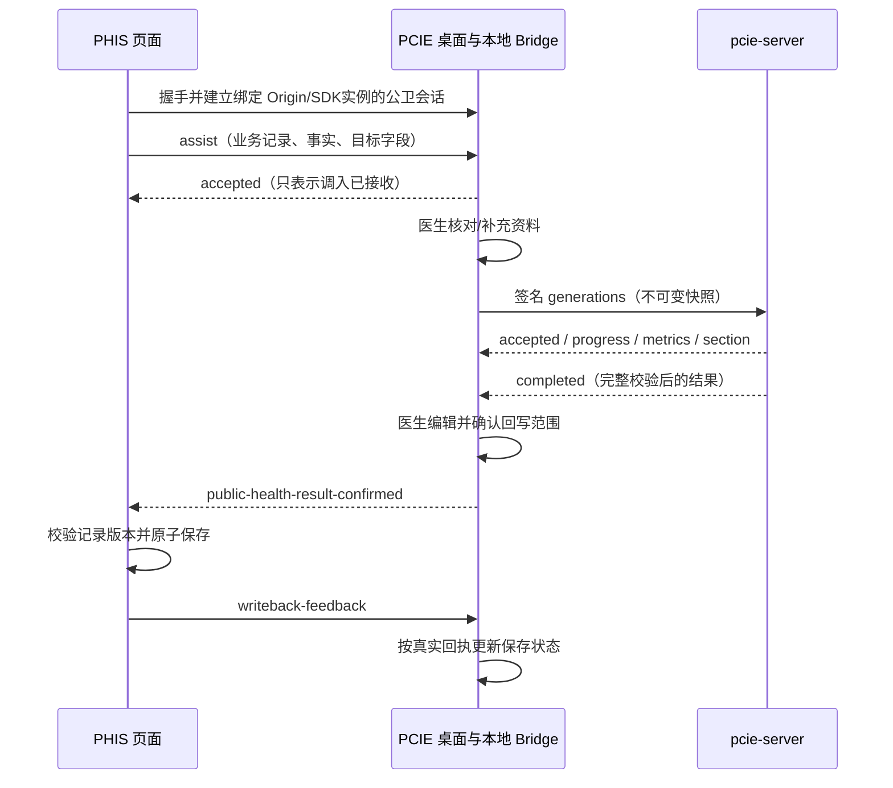

# 全医慧助（PCIE）公卫健康处方与减重助手设计

更新日期：2026-10-10。协议：`public-health.v1`。状态：**原生迁移实施中；生产实现、工程验证与真实 PHIS/医学验收分别记录**。

用户已确认：两个能力原生迁入 `pcie-server`，交付不依赖 BsoftGPT；PHIS 侧交付接入接口与约定。本文将“只给出接口”落实为 PCIE 定义调入、回传和回执协议，PHIS 团队负责本系统取数、字段映射与最终保存。

## 1. 当前证据与范围

### 1.1 已查看的初版

| 项目 | 实际配置 | 迁移资产 |
| --- | --- | --- |
| [360建议](http://10.17.2.208/app/ddb8d8fb-f9a3-4cbd-bb9a-e568fe009e06/configuration) | Qwen3-32B 聊天应用，单 system prompt；变量区与知识库区无配置 | 事实输入要求、检查白名单/间隔/准备事项字典、用药类别提醒、三类输出规则 |
| [减肥助手](http://10.17.2.208/app/7f8c770e-696b-4e3a-aae0-f834ab0dfd49/workflow) | person_info → 参数提取/必填判断 → BMI/BMR 代码；运动分支与地区食谱检索分支 → 文本合并 | 字段、公式、提示词、食谱与 METS 资料、检索配置、输出模板 |

以上为浏览器编辑器当前配置，未证明与四个月前发布版本一致，未提交真实居民数据运行模型。

健康处方当前包含未来90天检查计划、用药指导、生活方式建议。提示词要求调用方提供居民事实快照和受控规则；应用自身未展示 PHIS 取数/历史聚合模块，不将这一要求写成已实现能力。

减重详情：

- 参数：gender、name、age、weight_kg、height_m、area、activitys、activity_str、season、person_info；gender/age/weight/height/area/season 检查非空。
- BMI：`round(weight_kg / (height_m ** 2), 1)`。
- BMR：先米转厘米；女 `655 + 9.5*weight + 1.8*height_cm - 4.7*age`；男 `66 + 13.7*weight + 5.0*height_cm - 6.8*age`；保留一位小数。此处记录旧算法，不表示其临床适用性已验收。公式需按版本保留，迁移测试覆盖单位与取整。
- 食谱查询：`地区:{area}, 季节:{season},基础能量消耗:{bmr}kcal`。知识库“中国各地区食谱”，向量检索，`bge-reranker-large`，Top K=4，Score阈值关闭，元数据过滤关闭。
- “知识检索”仅关联一个知识库“METS 表”；“METS 匹配”是节点描述。
- “METS 计算”实为模型参数提取，指令是推测并输出活动与 METS。运动建议仅使用原始 person_info；最终模板绑定却不消费活动耗能变量。
- 最终 Markdown 为“减肥建议 / 活动建议（含 BMI/BMR） / 食谱推荐”。

现有性别提取允许“未知”，非空判断会放行，但 BMR 只接受男女；原生迁移必须在模型调用前返回明确缺失/无效字段，不能保留该异常路径。

### 1.2 与招标描述的差距

2026-10-10 补齐用户提供的 **3.4.1 随访健康处方**五项需求；完整需求保留在 [服务端 PRD](../../PRD.md#341-随访健康处方需求补充2026-10-10)，独立调入与回传示例见 [服务端 API](../../API.md#341-随访健康处方)。需求范围与当前实现覆盖分别记录。

| 要求 | 已见证据 | 本次处理 |
| --- | --- | --- |
| 归并随访、就诊、体检、慢病档案，构建健康画像（按用户澄清） | 发起方直接传入事实；助手派生当前画像、来源记录、最新/历史观察及已知风险 | 不要求主动取数或画像持久化；未来与最新冲突观察不能作为生成证据，更新资料后刷新画像 |
| 基于画像生成疾病预防、用药、饮食、运动健康教育 | 360建议有对应输出与限制，原生能力固定三分区 | 用药指导单列，疾病预防、饮食和运动教育归入生活方式；实际内容与批准 Prompt/规则另验 |
| 慢病进展/并发症潜在风险 | AI 六分区草稿中的风险引用绑定画像证据，类型、关注状态、干预建议严格验证 | 输出医生可核对的定性提示；专门量化模型、临床校准与预测概率不在当前验收内 |
| 根据年龄、性别、健康状况、风险等级推荐检查检验 | 已校验白名单、事实引用、90天范围、最短间隔，新增 eligibility 输入过滤和输出二次校验 | 机构批准检查目录和现场编码映射待验；检查优先级不等于居民风险等级 |
| PHIS/公卫随访系统数据、记录与业务编码一致 | 已有居民/记录/版本锚点、目标白名单、医生确认与保存回执协议 | 现场核对患者关联、观察/病种/用药类别/检查编码及可写字段，验证版本冲突与原子保存；真实对接尚待验收 |
| 运动/食谱个性化 | 减重工作流已配置 | 迁移输入、公式、提示词和真实知识资产 |
| 明确减重目标、血压/血糖监测 | 当前输出模板未固定约束 | 列为内容补齐项，另经业务/医学审核后版本化，不伪装成原样迁移 |
| 严格依据2024指南 | 尚未核对食谱库全文和来源版本 | 资产清单必须记录来源、版本、段落与审核状态；缺失时显示不可生成 |

### 1.3 页面基准

已重新打开 `http://127.0.0.1:4257/?page=treatment-plan`：它直接运行当前 PCIE 生产 Vue 组件，使用合成审查数据。采用已见的蓝色患者条、浅蓝灰背景、白色内容面、固定底部操作区。安装版原生窗口的两次读取超时；审查页不替代 Tauri 实机与真实 PHIS 验收。

新页面使用生产 Vue 组件，1120×760 独立工作区；资料核对、生成、医生编辑确认与 PHIS 保存回执各自保持状态和验收边界。

## 2. 职责划分与边界

### 2.1 随访健康处方实现补充（2026-10-10）

用户进一步明确：**多源资料由发起方直接传入，不要求助手自动查询外部系统**。继续使用 `public-health.v1` 的 `patient + facts`；观察可来自随访、就诊、体检或档案，摘要和已提供用药/病种共同构建只读健康画像。不新增外部取数端点、患者关联猜测或画像持久化。资料更新后画像、AI 输入与确认均使用当前快照。

减重助手与随访健康处方保持独立任务和结果范围：随访为三个章节，不依赖减重画像/食谱或指标；减重为运动/食谱两节，不包含随访健康画像、检查/用药或风险结果。共享认证、传输及页面基础设施不合并业务功能。观察时间对照保留 ISO 秒和小数精度，时区不同但同瞬间视为相同时间，避免亚毫秒未来数据被采用。

- 画像 Builder 派生 `patient / snapshotAt / conditions / medicationClasses / lifestyle / historySummary / nextFollowUpDate / latestObservations / knownRiskAssessments / sources / evidence / excludedObservationIds / conflicts`。仅采用 `observedAt <= snapshotAt` 的观察；同项目同最新时间、不同结果/单位作为冲突保留，不能选择一个当正常值。证据引用为 `patient:ageYears / patient:sex / observation:<id> / condition:<index> / medication:<index> / lifestyle:<key> / historySummary`，不由模型创建来源。缺失资料保持待补充。
- 已有风险分层通过普通观察传入，约定编码为 `risk_level / hypertension_risk_level / diabetes_risk_level / cardiovascular_risk_level`，保留原值、日期和来源；不增加请求对象的 `riskLevel` 字段。AI 生成慢病进展/并发症的**定性潜在风险提示和干预建议**，不生成概率、确诊或经校准的风险分数；没有证据可以返回空风险项。它与发起方已有风险等级分开展示。
- 健康处方仍为三个固定章节。`lifestyle_guidance` 内部模型响应改用 [HealthEducationDraft](contracts/public-health.health-education.schema.json)：`risks[{type,name,concern,evidenceRefs,intervention}],prevention[],diet[],exercise[],followup[],missingFacts[]`。`type=progression/complication`；`concern=attention/needs_assessment` 只表示 AI 关注/待评估。风险最多6项，必须引用画像已有证据；六个字段全部必传，拒绝未知字段、虚构证据、概率字段及超长正文。程序拼接为风险提示、疾病预防、饮食、运动、随访与待补充内容，沿用原章节选择和纯文本回写。模型建议供医生审核，不冒充量化预测模型验收。
- 随访教育草稿所有模型文本拒绝 `BMI / BMR`、减重目标、目标体重、三餐参考食谱/备选食谱及 `kcal / 千卡 / 卡路里`；健康教育不生成减重计算或方案。血压/血糖原值由程序证据行展示，模型正文不写 `mmHg / mmol/L` 等数值单位，不产生新的量化目标/停练阈值或把单次观察判为正常/异常；正文内容仍需医生审核，关键词校验不是医学效果验收。医生后续明确编辑不受该模型草稿检查替代。
- 检查仍由批准白名单控制。白名单可选 `eligibility={minAgeYears?,maxAgeYears?,sexes?,conditionCodes?,riskLevels?}`；条件按 AND，病种/风险列表各自为任一匹配。`riskLevels` 仅匹配上述已有风险观察的非冲突最新值，不能用 AI 关注级别代替。无适配项允许空清单；正式最短间隔、异常复查和准备字典保持服务端控制。
- 程序在内部模型输入生成 `checkScheduleConstraints[{code,routineEarliestDate,routineAvailable,abnormalRetestAvailable,abnormalRetestEarliestDate?}]`。取快照日与全部同编码非未来观察的最晚日期加批准间隔的较晚值；本次测量、各来源和冲突结果的实施日期都计入间隔。可安排窗口为快照日到其后90天（含边界）。异常复查须当前有效数值证据满足全部批准阈值才计算候选日期；无条件或不满足时 `abnormalRetestAvailable=false` 且省略异常日期。模型按可用模式及最早日期安排，输出再独立验证，不能引用年龄绕过日期约束。此派生日期清单不进入 PHIS 契约。
- 内部 [checks 草稿](contracts/public-health.check-plan.schema.json) 保留 `evidenceObservationIds`，新增可选 `evidenceRefs`（1–16项唯一画像ref，沿用风险证据字典）；至少一类引用非空，未知或未来/冲突观察均拒绝。缺少本项目基线时可以引用真实年龄/已提供病种作为规则适配依据，正文明确“尚未提供本项目既往结果”，不能冒充已有异常。异常短期复查仍必须由 `evidenceObservationIds` 的实际数值支持；引用年龄不能缩短间隔。这只改变内部模型校验，不改变 PHIS 请求/结果/确认纯文本契约。
- 正式编排与本机真实 AI 入口均执行画像和结构校验。测试入口的随访三个章节经原签名 `/v1/ai/chat` 生成，不再替换为 Mock；测试检查目录采用独立、注明公开规范来源与待医学复核的参考清单，不能发布为正式批准资产。正式服务继续默认关闭并使用本机构批准规则/Prompt。

组件边界：`PublicHealthHealthProfile.vue` 只展示派生画像；`publicHealthHealthProfile.ts` 负责事实和证据投影；`publicHealthHealthEducation.ts` 负责内部草稿校验与确定性正文；现有页面/控制器仍管理医生编辑、选择、冻结和回执。服务端独立画像/教育纯规则接入现有编排，不新增全局状态或数据库表。

- PHIS：提供本次业务记录和资料快照，声明真实可写字段，完成本系统校验与保存，回传保存结果。
- PCIE：唤起、资料核对、受控补充、结果展示/编辑/选择、确认冻结、任务隔离与回执；不持有第三方密钥，不运行医学计算或拼 Prompt。
- pcie-server：可信机构上下文、输入与规则校验、版本化 Prompt、确定性计算、独立知识检索、模型编排、结构验证、执行与版本记录。
- Benchmark 本轮不改协议，不产生医学成绩，不写真实 PHIS。
- 管理端优先复用现有 Prompt/配置管理；本轮不新增通用工作流平台或知识库管理页面。

## 3. 契约归属与接口

机器可读实施契约：[OpenAPI](contracts/public-health.openapi.json)。合成对接示例：[examples](contracts/public-health.examples.json)。本文负责跨仓决策；本地协议入口登记在 `pcie/api.md`，远端入口登记在 `pcie-server/API.md`。

| 接口 | 调用方 → 接收方 | 含义 |
| --- | --- | --- |
| POST `/api/public-health/assist` | PHIS → 本地 PCIE | 创建/恢复公卫任务，打开资料/结果页 |
| POST `/api/public-health/handshake` | PHIS → 本地 PCIE | 受控来源与配对凭据认证，签发/续期公卫会话 |
| POST `/v1/public-health/generations` | PCIE → 服务端 | 按 capability 生成，SSE 返回业务事件 |
| WS `public-health-result-confirmed` | 本地 PCIE → 发起 PHIS 实例 | 已确认的待保存内容；不是已保存 |
| POST `/api/public-health/writeback-feedback` | PHIS → 本地 PCIE | 保存成功或明确失败的业务回执 |

本地结果复用现有 WS 路径，已新增独立公卫分支、会话级路由和公卫专用 envelope。当前咨询广播与最新结果槽不能直接用来承载公卫任务。禁止新增长轮询结果接口。

### 3.1 公共请求

| 字段 | 约束 |
| --- | --- |
| schemaVersion | 固定 `public-health.v1`，不接受隐式旧别名 |
| requestId | UUID，签名 JSON body 内业务幂等键；不是 HTTP 追踪头 |
| originRequestId | UUID，首次 PHIS assist 时等于 requestId，后续补充资料/重新生成保持不变，用于关联发起实例与整个公卫任务 |
| capability | `health_prescription` / `weight_management` |
| scene | `hypertension_followup` / `diabetes_followup` / `elderly_exam` |
| patientId | 非空居民标识，不可降级到姓名或任意 id |
| businessRecordId | 当前随访/体检记录ID；草稿也需要 PHIS 分配稳定ID |
| recordVersion | PHIS提供的不透明版本；无版本机制时需由PHIS提供等价修改冲突标识 |
| snapshotAt | 带时区ISO8601；输入资料快照时点 |
| patient | name、sex(male/female/unknown)、ageYears；不传身份证/联系方式等非必要信息 |
| facts | observations、conditions、medicationClasses、lifestyle、historySummary、nextFollowUpDate、按需weightProfile |
| writebackTargets | 目标字段白名单与章节映射，见下节 |

每项 observation 包含 `id/code/value/unit?/observedAt/source{system,recordId}`。事实缺失与明确否认分开：未提供不等于正常，不等于没有慢病。不得让模型猜测测量值、观察日期、性别或年龄。

weightProfile 的 `heightCm/weightKg/region/season` 使用明确单位与枚举。PHIS可填充；缺失在桌面补充，来源标为医生补充。补充后的完整快照使用新 requestId，原请求与原结果保留，不原地改写。

实现收口：远端减重请求必须包含`heightObservationId/weightObservationId`，分别引用observations中code为height/weight、unit为cm/kg的数值事实，且与profile值一致；缺引用返回MISSING_FACTS，冲突返回INVALID_REQUEST，不自动选取不同日期的历史测量。observedAt是真实测量时间，不以录入时间替代。医生补充的source.system为PCIE_MANUAL、recordId为独立UUID；地区/季节可用weightProfile.contextSource记录来源。来源标签不作为身份认证证明。

桌面补充保存后立即按上述显式引用优先展示“本次采用”的身高/体重，原始与未采用测量保留在可展开的历史区；减重运动/饮食展示 profile 的当前值，不能同时回显旧 lifestyle 值。引用不匹配时不推断采用值，仍提示核对。该投影只影响展示，完整请求、原始来源及 PHIS 版本语义保持不变；重新打开资料窗口与重新生成须使用同一份更新后的资料。

机构与设备从服务端设备鉴权上下文确定；PHIS页面传入的人员/机构名称只是上下文，不能当授权凭证。检查白名单、间隔、药物类别字典由服务端机构配置解析，版本进入结果，不允许 PHIS 动态发送 system prompt、模型名、API key 或任意知识服务URL。

### 3.2 输出与回写映射

固定章节：

| capability | id | 标题 |
| --- | --- | --- |
| health_prescription | check_plan | 检查计划 |
| health_prescription | medication_guidance | 用药指导 |
| health_prescription | lifestyle_guidance | 生活方式建议 |
| weight_management | exercise_plan | 运动建议 |
| weight_management | meal_plan | 食谱推荐 |

返回 `sections[{id,title,content}]` 与结构化生成信息。减重另有只读 `metrics{bmi,bmrKcalPerDay,formulaVersion}`；结果记载 `promptVersions/knowledgeVersions/generatedAt/warnings`。指标不由医生直接改写；修改身高等事实后重新计算生成。

目标项为 `{targetFieldId,label,sourceSections:[...],valueType:"string",mode:"replace"}`。一个目标可合并多章，章节按固定顺序确定性拼接为纯文本；每个章节只能映射到一个目标，目标ID唯一。可整稿写入一个“健康指导”字段，也可拆为多个字段。实际 PHIS 字段ID/长度/换行规则尚待对接方提供，示例ID仅为合成。

一次回传 `items[{targetFieldId,sourceSections,value}]`：严格属于启动时冻结的映射。合并目标包含的全部章节选中才可写该字段，不允许隐式部分替换；未返回的目标保持原值。空白值禁止提交，第一版不承载清空、追加、复杂表单或处方/医嘱写入。PHIS需原子保存整批；不能将部分保存报告为 success。

### 3.3 身份与幂等

业务键：可信机构 + patientId + scene + businessRecordId。稳定任务锚点为originRequestId；生成额外绑定capability、requestId、recordVersion、完整事实和目标映射摘要。

桌面创建新生成requestId时，必须继承originRequestId拥有的会话、居民、场景、业务记录与能力。PHIS按最初调入的originRequestId关联回传，并校验完整业务身份；不要求它预先知道桌面后续生成的requestId。跨居民、场景、业务记录或能力切换必须建立新originRequestId，不能将旧会话任务借给另一任务。

- 同一机构/设备作用域内同 requestId、同规范化快照：恢复相同生成；不同快照：409 `REQUEST_ID_CONFLICT`。
- 新一轮生成使用新 requestId；开始前保留医生草稿，明确告知将生成新版本。
- generationId唯一对应一次生成产物。一次保存尝试对应 writebackRequestId 与冻结内容；尚未获得终态时的网络重传沿用该ID，修改内容后必须新ID。收到明确failed回执后，医生再次确认保存属于新尝试，即使正文不变也使用新writebackRequestId；旧ID仅重放原失败，不能转为success。
- PHIS按writebackRequestId去重并校验recordVersion。同ID不同内容拒绝；版本变化返回`RECORD_VERSION_CONFLICT`，保留草稿并要求重新调入最新记录。
- 所有事件和回执校验requestId、generationId、writebackRequestId（适用时）和完整业务身份。晚到/跨记录事件不改变当前页面。
- 终态success不退回pending/failed；重复同终态回执幂等。HTTP断开或等待超时是结果未知，不伪造保存失败，不能在未确认旧请求状态时产生重复追加。

### 3.4 认证与会话隔离

远端保持 deviceToken + ECDSA P-256，签名覆盖实际请求体。沿用当前签名字段，不向PHIS暴露设备私钥。`X-Request-Id`仅追踪，不用作业务幂等键。

本地公卫接口不继承现有宽松CORS作为安全保证。公卫独立`POST /api/public-health/handshake`：Origin与X-PCIE-Pairing-Key，body为schemaVersion、sdkInstanceId与可选resumeSessionId，返回status=ready、bridgeSessionId/publicHealthBridgeToken/expiresAt/renewUntil。部署配置PCIE_PUBLIC_HEALTH_ALLOWED_ORIGINS为完整Origin逗号列表，PCIE_PUBLIC_HEALTH_PAIRING_SECRET为至少32随机字节的base64密钥；两项默认空即拒绝，不自动启用部署权限。令牌256位随机、仅内存、30分钟有效，通过X-PCIE-Bridge-Token传递，不进URL/日志。续期须旧token+配对密钥+同Origin/sdkInstanceId，可在到期后30分钟宽限内恢复，稳定sessionId和任务所有权，只轮换token。

既有门诊握手仅验证EMR token非空，不能据此声称已完成PHIS账号真实性验证。公卫采用上述独立配对握手并绑定允许Origin、SDK实例和会话；远端机构/设备以现有签名认证上下文为准，不能把请求体机构/人员字段当认证结果。PHIS医生账号真实性仍由PHIS身份体系负责。

WS连接先完成公卫订阅认证并绑定会话；公卫帧只投递到拥有该originRequestId及其派生requestId的实例，不能先向所有连接广播再靠SDK过滤。门诊既有帧语义不变，公卫帧不伪造consultationId。

WS沿用/api/consultation/events/ws，公卫专用连接附channel=public-health（不含凭据），首帧public-health-subscribe包含schemaVersion、bridgeSessionId、publicHealthBridgeToken与可选after事件ID。认证后ack为public-health-subscribed及session/expiry，失败public-health-error后关闭；未知或别的会话游标返回EVENT_CURSOR_INVALID。到期连接关闭，续期不能改变任务所有权或writebackRequestId去重空间。详细HTTP/WS/Tauri字段见pcie/api.md第8节。该配对机制认证集成实例，不宣称完成PHIS医生账号验证。

桌面prepare仅允许相同业务锚点、recordVersion及目标映射下更新facts/snapshotAt；patient.name/ageYears固定，sex只允许unknown补充为male/female，并提供sexSource={system:PCIE_MANUAL,recordId:UUID}。明确性别、源记录版本或目标映射变更必须由PHIS以新origin重新调入。

### 3.5 SSE与错误

按顺序发送 `accepted → progress/metrics/section → completed`，失败发送`failed`。每帧带originRequestId、requestId、generationId、streamId、sequence；completed携带完整、校验通过的结果。心跳仅保活，不算进度。`[DONE]`或连接关闭都不能替代completed。

每次连接或重放使用新streamId，sequence仅在该流内从1递增，SSE id为streamId:sequence。客户端以当前连接的accepted绑定streamId并重置序号，通过本地运行标记拒绝旧连接迟到帧；不能跨流沿用上次序号。相同requestId恢复已完成生成时保持generationId，但可在新流重放accepted与completed，不能把它们误判为旧帧丢弃。

每个section事件为整节快照，不直接累计重复文本；同一流内sequence乱序/重复丢弃。生成中可阅读已完成章节，完成前不开放编辑与回写，避免模型覆盖医生输入。部分结果后断流保留可见内容并禁用回写；显式恢复同请求只读取原执行状态，显式重新生成使用新requestId，不自动重跑模型。

第一版没有远端取消接口。界面动作命名为“停止等待”：本地离开生成态并忽略该次迟到事件，不代表服务端执行已取消，也不保证停止上游计费。需要真正中止模型调用时须另行冻结取消协议。

工程上限：整体生成180秒、SSE心跳15秒、请求JSON不超过512KiB、单节不超过16000字符、总结果不超过64000字符。超限在生成前或结果校验时明确拒绝；对接后据真实字段限制收紧，不能静默截断。30秒普通HTTP默认超时不能直接用于此接口。

| 错误码 | 医生/接入方处理 |
| --- | --- |
| INVALID_REQUEST / MISSING_FACTS | 按missingFields补充，生成请求尚未进入模型 |
| REQUEST_ID_CONFLICT / GENERATION_IN_PROGRESS | 保留现场；同一请求不启动第二次生成 |
| POLICY_NOT_READY / KNOWLEDGE_NOT_READY | 显示配置/资料未就绪，禁止用模型自由发挥补齐 |
| INVALID_MODEL_OUTPUT / GENERATION_FAILED | 保留已显示内容，不能回写不完整结果 |
| RECORD_VERSION_CONFLICT | 保留草稿，回PHIS重新调入最新记录 |
| WRITEBACK_ID_CONFLICT / TASK_CONTEXT_MISMATCH | 拒绝错误回执，不能覆盖其他居民/记录状态 |
| BRIDGE_SESSION_EXPIRED | 重新握手，只恢复属于原实例的有效任务 |

## 4. 页面与状态

工作视图`public-health`独立于门诊`currentPatient`。初始1120×760、最小900×620；复用主窗口transition协调器，不由业务组件直接改原生几何。

| 状态 | 内容与动作 |
| --- | --- |
| 待生成 | 居民与本次业务锚点、事实摘要、目标字段；生成可用 |
| 资料缺失 | 具体字段就地补充；不把缺失写成正常，不生成虚构值 |
| 生成中 | 展示实际阶段与已完成章节；可停止等待，禁用重复生成/回写 |
| 待确认 | 正文分区可编辑，指标只读，目标字段可选择 |
| 等待回执 | 冻结本次提交，按钮显示等待PHIS；保留可见内容 |
| 保存成功 | 显示已保存记录与回执时间；不自动诊毕、不清空其他任务 |
| 保存失败/版本冲突 | 保留医生编辑，按具体错误处理；版本冲突不可盲目重试 |
| 知识未就绪 | 明确缺资产；不展示伪造的生成结果 |

收起保留当前运行期现场；放弃只结束本地当前公卫任务的交互与结果接收；不得调用现有门诊退出逻辑去取消门诊session。重启恢复只有落盘和隐私生命周期实现并验收后才能宣称支持。

真实产品主界面不展示requestId、SSE、Prompt或模型路由等实现细节；设计预览的“接口预览”折叠区用于交付核对。

## 5. 原生实现落点

- 客户端：`features/public-health/{types,api,lib,model,ui}`，App仅装配；独立Bridge controller、SDK公卫分发、Rust任务/回执registry。复用PatientHeader时传空payType，不沿用默认“自费”。不新增Pinia store。
- 签名SSE：复用regional传输与签名基础，新增业务事件decoder。现有createRegionalSSE只解码OpenAI delta，不能直接消费公卫事件。
- 服务端：`modules/publichealth`内由`PublicHealthGenerationService`处理请求、运行与事件，`PublicHealthOrchestrator`编排两个能力，`PublicHealthModelService`复用`AiProxyService.chat`和`PromptService.resolveEffectivePrompt`。资产核验、食谱检索、确定性指标计算及运行存储分别由独立service负责；保留用户在AiProxyService里的其他工作。
- 生成运行表：`c_ai_ph_origin`绑定调入上下文，`c_ai_ph_run`保存执行。生成前短事务占位，模型调用不持数据库事务；成功/失败另事务记录。唯一键和输入hash防并发重复；记录prompt/知识/算法版本。崩溃留下RUNNING时保留执行未完成状态，不自动抢占重跑；尚未实现崩溃回收作业。
- 数据库变更同步Oracle/GaussDB init基线及README/Schema测试，不新增常驻upgrade脚本；现场迁移由DBA按现库生成一次性脚本。DM8按现有兼容基线验证；本设计不宣称数据库已升级。

## 6. 知识与内容迁移门槛

正式生成由服务端加载机构批准清单、带版本及 SHA-256 的规则/食谱资产与发布 Prompt；请求不能指定资产路径、供应商凭据、机构或模型。未配置、未批准、内容哈希不符或检索失败时明确阻断。工程取回原文、构建向量和检索验证分别留有本机证据，不能自动转为医学批准或启用正式公卫。

食谱索引的生产召回保持向量与重排两阶段，由实施方给离线工具显式提供候选输入和查询。工具不修改线上配置、不创建批准 manifest。正式目录须由机构按真实来源、分段、版本、机构范围和医学适用性审核；资产取回过程及调试入口不随本功能分支提交。
